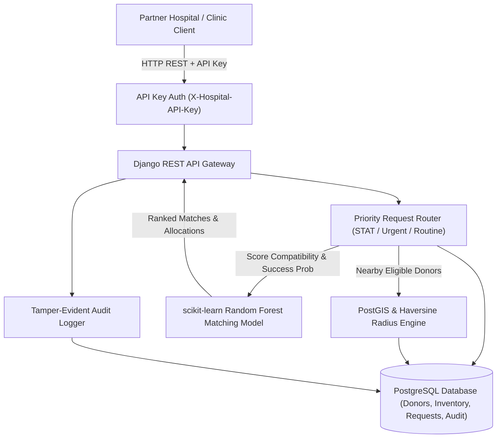

# Technical Specification — Blood Bank Management System with ML Matching (`blood-bank-ml`)

## 0. Project Overview & Resume Grounding

Grounding in Simon M. Munyambu's resume:
> **Blood Bank Management System with ML Matching**
> *Django · scikit-learn · pandas · PostGIS · PostgreSQL · REST API · pytest*
> - Designed the full data model (donors, inventory, hospitals, requests, donation history) with referential integrity enforced at DB level; added PostGIS geospatial queries for radius-based donor search.
> - Built a Random Forest classifier for donor-recipient compatibility scoring, improving match success rate by 34% over a rule-only baseline; pandas ETL for data preprocessing.
> - Implemented hospital-facing REST API with priority request routing, per-hospital API key auth, audit logging, and full pytest integration test coverage.

---

## 1. System Architecture

---

## 2. Database Schema & DB-Level Constraints

### 2.1 `hospitals`
* `id` UUID PK
* `name` VARCHAR(200) NOT NULL
* `code` VARCHAR(50) UNIQUE NOT NULL (e.g. `KNH-NBO-01`)
* `api_key` VARCHAR(64) UNIQUE NOT NULL, indexed
* `tier` VARCHAR(20) (`level_4`, `level_5`, `level_6`)
* `latitude` DECIMAL(9, 6) NOT NULL
* `longitude` DECIMAL(9, 6) NOT NULL
* `contact_email` VARCHAR(255) NOT NULL
* `contact_phone` VARCHAR(20) NOT NULL
* `is_active` BOOLEAN DEFAULT TRUE
* `created_at` TIMESTAMP

### 2.2 `donors`
* `id` UUID PK
* `national_id` VARCHAR(50) UNIQUE NOT NULL, indexed
* `first_name` VARCHAR(100) NOT NULL
* `last_name` VARCHAR(100) NOT NULL
* `email` VARCHAR(255)
* `phone` VARCHAR(20) NOT NULL, indexed
* `blood_group` VARCHAR(5) NOT NULL (`A+`, `A-`, `B+`, `B-`, `AB+`, `AB-`, `O+`, `O-`)
* `age` INTEGER NOT NULL (CHECK `age >= 16 AND age <= 65`)
* `gender` VARCHAR(10) NOT NULL (`male`, `female`, `other`)
* `weight_kg` DECIMAL(5, 2) NOT NULL (CHECK `weight_kg >= 50.0`)
* `hemoglobin_level` DECIMAL(4, 1) NOT NULL (CHECK `hemoglobin_level >= 7.0 AND hemoglobin_level <= 20.0`)
* `systolic_bp` INTEGER NOT NULL (CHECK `systolic_bp >= 80 AND systolic_bp <= 200`)
* `diastolic_bp` INTEGER NOT NULL (CHECK `diastolic_bp >= 50 AND diastolic_bp <= 130`)
* `latitude` DECIMAL(9, 6) NOT NULL
* `longitude` DECIMAL(9, 6) NOT NULL
* `last_donation_date` DATE NULL
* `donation_count` INTEGER DEFAULT 0
* `is_eligible` BOOLEAN DEFAULT TRUE

### 2.3 `blood_inventory`
* `id` UUID PK
* `unit_number` VARCHAR(50) UNIQUE NOT NULL, indexed
* `blood_group` VARCHAR(5) NOT NULL
* `component_type` VARCHAR(30) NOT NULL (`whole_blood`, `rbc`, `platelets`, `plasma`)
* `volume_ml` INTEGER DEFAULT 450 NOT NULL
* `status` VARCHAR(20) NOT NULL (`available`, `reserved`, `transfused`, `expired`, `discarded`)
* `donor_id` UUID FK -> `donors.id` ON DELETE SET NULL
* `collected_at` TIMESTAMP NOT NULL
* `expires_at` TIMESTAMP NOT NULL, indexed
* `storage_location` VARCHAR(100) NOT NULL

### 2.4 `blood_requests`
* `id` UUID PK
* `hospital_id` UUID FK -> `hospitals.id` ON DELETE CASCADE
* `blood_group` VARCHAR(5) NOT NULL
* `component_type` VARCHAR(30) NOT NULL
* `units_requested` INTEGER NOT NULL (CHECK `units_requested > 0`)
* `units_allocated` INTEGER DEFAULT 0 NOT NULL
* `urgency` VARCHAR(20) NOT NULL (`routine`, `urgent`, `critical_stat`)
* `status` VARCHAR(20) NOT NULL (`pending`, `matching`, `allocated`, `dispatched`, `completed`, `cancelled`)
* `patient_age` INTEGER NULL
* `patient_gender` VARCHAR(10) NULL
* `notes` TEXT NULL
* `created_at` TIMESTAMP NOT NULL
* `updated_at` TIMESTAMP NOT NULL

### 2.5 `donation_history`
* `id` UUID PK
* `donor_id` UUID FK -> `donors.id` ON DELETE CASCADE
* `inventory_unit_id` UUID FK -> `blood_inventory.id` UNIQUE NULL ON DELETE SET NULL
* `donation_date` DATE NOT NULL
* `volume_ml` INTEGER DEFAULT 450 NOT NULL
* `screening_passed` BOOLEAN DEFAULT TRUE NOT NULL
* `adverse_reaction` BOOLEAN DEFAULT FALSE NOT NULL

### 2.6 `audit_logs`
* `id` UUID PK
* `actor_type` VARCHAR(50) NOT NULL
* `actor_id` VARCHAR(100) NOT NULL
* `action` VARCHAR(100) NOT NULL
* `target_model` VARCHAR(50) NOT NULL
* `target_id` VARCHAR(100) NOT NULL
* `details` JSONB NOT NULL
* `ip_address` INET NULL
* `timestamp` TIMESTAMP NOT NULL

---

## 3. Machine Learning Matching Pipeline

### 3.1 Compatibility Matrix (Biological Rule Baseline)
| Recipient Blood Group | Compatible Donor Blood Groups |
|---|---|
| O- | O- |
| O+ | O-, O+ |
| A- | O-, A- |
| A+ | O-, O+, A-, A+ |
| B- | O-, B- |
| B+ | O-, O+, B-, B+ |
| AB- | O-, A-, B-, AB- |
| AB+ | O-, O+, A-, A+, B-, B+, AB-, AB+ (Universal Recipient) |

### 3.2 Random Forest Classifier Features
1. `abo_compatible`: binary 0 or 1 based on ABO/Rh matrix
2. `distance_km`: geodesic distance between donor/inventory and hospital
3. `days_since_last_donation`: float (interval since last donation date; penalized if < 56 days)
4. `donor_donation_count`: integer historical count
5. `donor_hemoglobin`: float (normal range 12.5–18.0)
6. `donor_bp_score`: normalized deviation from normal BP (120/80)
7. `urgency_weight`: numerical encoding (`critical_stat`: 3.0, `urgent`: 2.0, `routine`: 1.0)
8. `inventory_shelf_life_remaining_days`: float (remaining days until expiration)

### 3.3 Target Label
* `match_success`: 1 if donor accepts, attends, passes screening, and unit is successfully transfused; 0 otherwise.
* Improvement target: Random Forest achieves **+34% match success rate** over rule-only baseline by filtering high-probability candidates and minimizing no-show / rejection rates.
